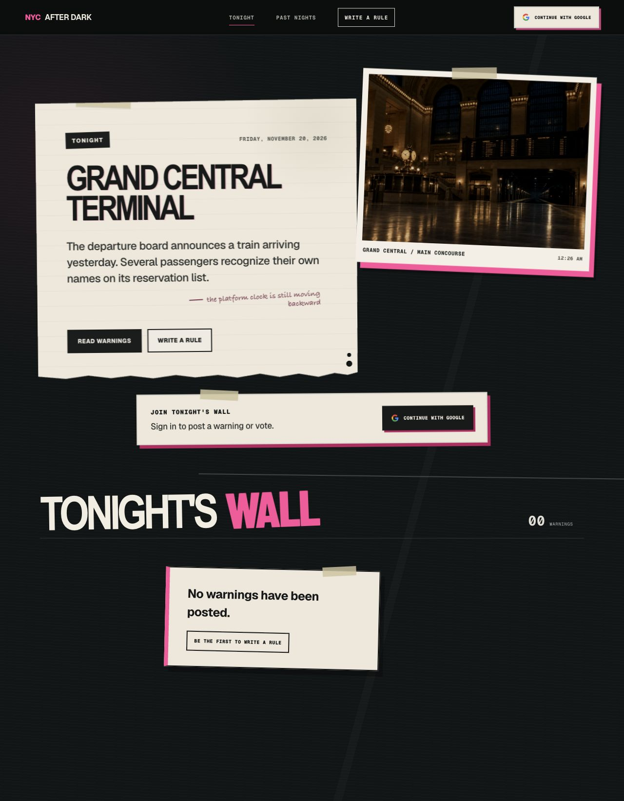
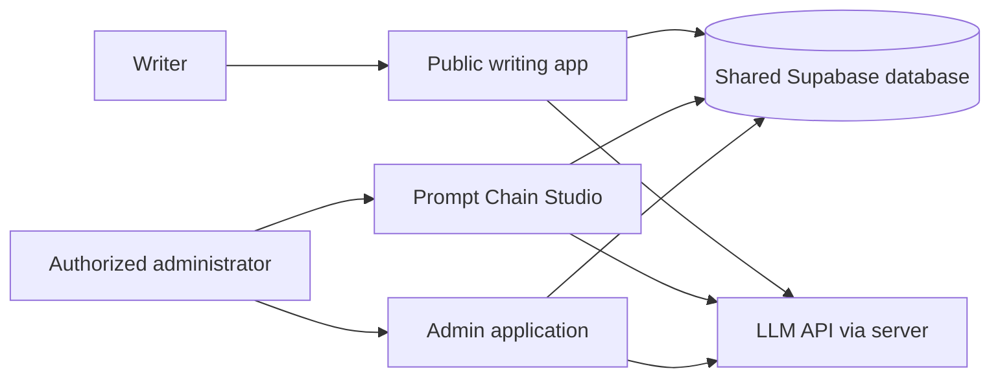

# NYC After Dark

**An AI-assisted writing web app where people start with their own idea, revise a generated draft, and choose what to publish.**

[Live app](https://coms6998-sand.vercel.app/) · [Engineering walkthrough](docs/portfolio/engineering.md) · [Run a prompt-chain example](examples/prompt-chain/README.md)

NYC After Dark turns fictional New York night scenes into a community writing prompt. Readers browse without an account; signed-in writers contribute short warnings and vote on published contributions.



*Public homepage captured November 20, 2026. The featured scene rotates daily.*

## Writing with AI

1. Write an original instruction for the night's scene.
2. Generate a private AI draft, automatically saved to your account.
3. Edit the wording or regenerate the draft.
4. Click **Publish Notice** to save the edited text and make it public.
5. Read other contributions, vote, or undo your vote.

The author controls the starting idea, final wording, and publication. Manual edits remain in the browser until publication; there is no separate save action for those edits in this version.

## My contribution

I independently designed and implemented NYC After Dark and its companion Admin and Prompt Chain Studio applications as a Columbia COMS 6998 course project.

- **User application:** Next.js/TypeScript interface, Google sign-in, server-side LLM generation, private drafts, explicit publication, community voting, and Supabase access controls.
- **Prompt Chain Studio:** ordered workflow editing, model and prompt configuration, execution snapshots, output handoff between steps, and inspection of completed and failed runs.
- **Admin:** server-side authorization, restricted database operations, and interfaces for reviewing content and generation records.

The [engineering walkthrough](docs/portfolio/engineering.md) connects these features to source files and describes their integration boundaries. The [standalone runner example](examples/prompt-chain/README.md) demonstrates the Studio's execution logic with synthetic inputs and a mocked model, without an API key or administrator account.

## Architecture



The public app uses its own generation route and prompt. It does not dynamically execute chains configured in Studio. All three applications share the database; Studio and Admin require administrator authorization.

## Run locally

```bash
npm ci
cp .env.example .env.local
# Configure your Supabase project and server-only OpenAI key.
npm run dev
```

See [setup and operations](docs/USAGE.md) for database migrations, OAuth configuration, and environment variables. This repository contains incremental application migrations rather than a complete empty-database bootstrap. The optional generation-observability RPC is supplied by the companion Admin project's Week 7 migration.

Public-app checks (including OAuth redirect regression tests):

```bash
npm test
npm run test:demo
npm run lint
npm run typecheck
npm run build -- --webpack
```

## Scope and versions

The writing workflow is based on public-app source commit [`ccbc94a`](https://github.com/Acadia2049/coms6998/tree/ccbc94a719ed2c42a99e3be7d4cd6f99668b374e). The [October UI and prompt archives](docs/versions/README.md) document earlier releases. This portfolio update adds OAuth redirect hardening, regression tests, and CI. The separate Understudy iteration is outside this walkthrough.

NYC After Dark demonstrates AI-assisted composition and application engineering. It does not yet implement randomized treatments, research consent, or suggestion-level acceptance and editing events. Successful generations have best-effort observability; the current records are not a complete behavioral event log.
