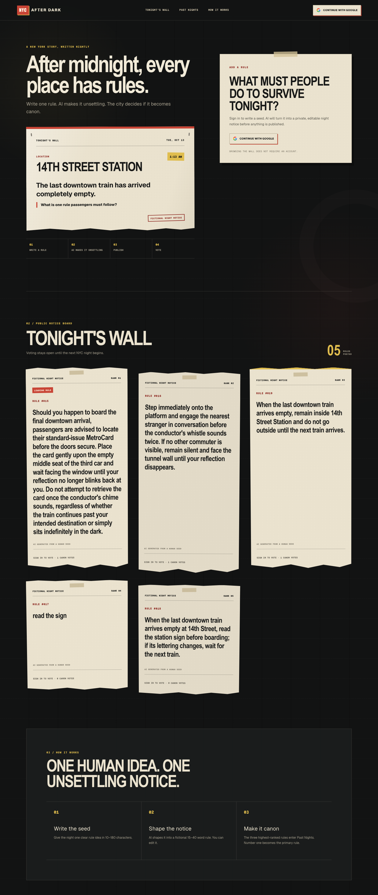
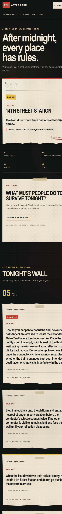
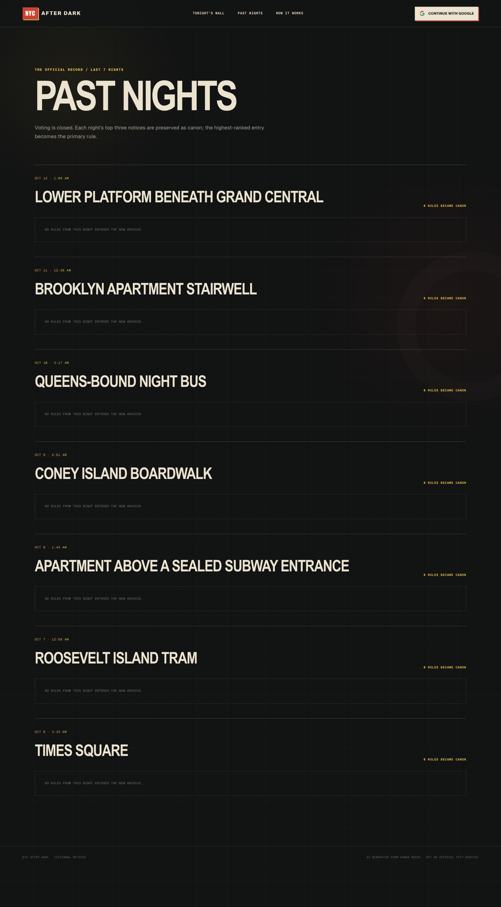

# NYC After Dark Snapshot — 2026.10.13.1

This is the canonical record of the deployed notice-wall UI and OpenAI Luna
generation behavior on October 13, 2026.

## Identity

| Field | Value |
| --- | --- |
| Snapshot version | `2026.10.13.1` |
| Captured | `2026-10-13 11:32:44 EDT` (`America/New_York`) |
| Source commit | `3b49b545291c6fd008c36d1c30ebb6b8ae3a7795` |
| Source branch | `main` |
| Archive tag | `snapshot-2026-10-13-openai-luna` |
| Package version | `0.1.0` |
| Production URL | <https://coms6998-coms-6998.vercel.app/> |
| Production deployment | `coms6998-m0xbxaljl-coms-6998.vercel.app` |
| GitHub deployment record | `7041366446` |

To inspect this saved version after the tag exists:

```bash
git switch --detach snapshot-2026-10-13-openai-luna
```

To continue from it on a new branch:

```bash
git switch -c restore-2026-10-13 snapshot-2026-10-13-openai-luna
```

## UI snapshot

The screenshots are production captures made while signed out, so they preserve
the public home, sign-in state, Tonight's Wall, and archive rather than private
account data.

### Homepage — desktop, 1440 × 3400



### Homepage — mobile, 390 × 3200



### Past Nights — desktop, 1440 × 2600



See [UI capture metadata](ui/README.md) for checksums and reproduction details.

## Visual system

- Concept: a fictional municipal notice board after midnight.
- Base: near-black grid wall with warm paper notices.
- Accents: emergency red, caution yellow, aged cream, muted gray.
- Typography: condensed display headlines, editorial serif support copy, and
  monospaced micro-labels.
- Core surfaces: sticky-tape paper cards, torn lower edges, numbered wall
  notices, understated grid and circular shadow motifs.
- Navigation: Tonight's Wall, Past Nights, How It Works, Google sign-in.
- Responsive behavior: two-column desktop hero collapses into a single-column
  mobile flow; wall cards stack vertically.

The source of truth for this design is `app/night.css`, with page composition in
`app/page.tsx`, `app/past-nights/page.tsx`, and `app/components/`.

## Implemented product behavior

- Fourteen NYC night scenes rotate by New York calendar date.
- Public visitors can browse Tonight's Wall and Past Nights.
- Google authentication runs through Supabase Auth.
- Signed-in users submit one 10–180 character human rule seed.
- OpenAI creates a private, editable 15–40 word fictional notice.
- Regeneration replaces the same unpublished draft instead of adding duplicates.
- Publishing moves the draft onto the public wall and clears the composer.
- Users cast one Make Canon vote per published rule.
- The top three rules from each of the previous seven nights are shown in the
  read-only archive; rank one is the primary rule.
- Stable scene IDs separate new wall content from legacy challenge rows.
- Supabase Row Level Security protects drafts, ownership, publishing, and votes.

## AI configuration

| Setting | Value |
| --- | --- |
| Provider | OpenAI Responses API |
| Endpoint | `POST https://api.openai.com/v1/responses` |
| Model | `gpt-6-luna` |
| Reasoning effort | `none` |
| Service tier | `fast` by default; configurable with `OPENAI_SERVICE_TIER` |
| Maximum output | `100` tokens |
| Server timeout | `6000` ms |
| Response target | `15–40` English words |
| Storage at OpenAI | disabled with `store: false` |
| Automatic retry | none |
| Hidden repair call | none |

The full system instruction, dynamic input template, and request body are saved
in [prompts/rule-generation.md](prompts/rule-generation.md). The executable
source remains `lib/challenges.ts` and `app/api/generate/route.ts`.

## Data and API contracts

- `POST /api/generate`
  - Body: `{ seed, draftId? }`
  - Authentication required.
  - Inserts a private draft or updates the current private draft.
- `PATCH /api/submissions/[id]/publish`
  - Body: `{ text }`
  - Publishes only the current user's unpublished draft for the active scene.
- `POST /api/votes`
  - Body: `{ captionId }`
  - Accepts only a published rule from Tonight's Wall.

Database migrations required for this snapshot:

```text
supabase/migrations/20261007_week4_nyc_after_dark.sql
supabase/migrations/20261013_allow_draft_regeneration.sql
```

## Verification recorded for this snapshot

- `npm run build -- --webpack`: passed.
- `npx tsc --noEmit`: passed.
- `npm ls --depth=0`: passed.
- `npm run lint`: passed with two pre-existing `no-img-element` warnings.
- `git diff --check`: passed before the production commit.
- Five direct OpenAI calls using the production prompt: five succeeded.
- Direct generation latency: average `1559 ms`, minimum `1114 ms`, maximum
  `1866 ms`; all responses used Fast processing and contained 15–40 words.
- Vercel Production deployment: succeeded.
- Production `/`: returned `200` and contained the new NYC After Dark UI.
- Production unauthenticated `/api/generate`: returned the expected `401`.

## Known boundaries

- A complete production test still requires a signed-in browser session to
  exercise generate → edit/regenerate → publish → second-account vote.
- Preview deployments require their own Supabase environment-variable scope.
  The Preview created from the source commit returned `500` because its Supabase
  variables were not available, while Production returned `200`.
- The 390 px capture records the shipped mobile behavior exactly. The layout
  stacks vertically, but some header, notice, and long-text content extends past
  the right edge; this is a known responsive UI issue in this snapshot.
- The stable production URL is `coms6998-coms-6998.vercel.app`; the shorter
  `coms6998.vercel.app` currently points to an older, different project.
- Live wall content is database-backed and can differ from the screenshots even
  when the code and design remain identical.
