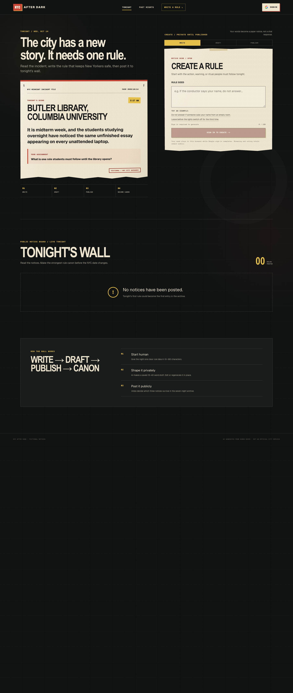
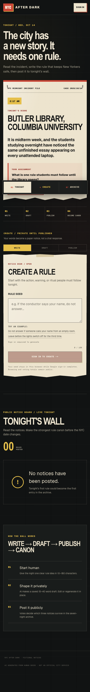
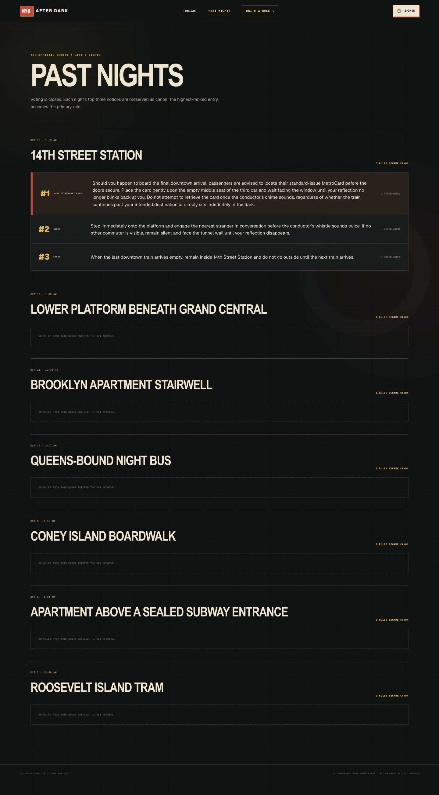

# NYC After Dark Snapshot — 2026.10.14.1

This is the canonical record of the Week 5 product iteration deployed on
October 14, 2026. It preserves the refined creation flow, responsive navigation,
public wall, archive, and unchanged OpenAI Luna generation contract.

## Identity

| Field | Value |
| --- | --- |
| Snapshot version | `2026.10.14.1` |
| Captured | `2026-10-14 16:22:27 EDT` (`America/New_York`) |
| Source commit | `47fb2cb9edd1e2da2f51f67de4b07f13c1c2e7cc` |
| Source branch | `main` |
| Archive tag | `snapshot-2026-10-14-week5-iteration` |
| Package version | `0.1.0` |
| Production URL | <https://coms6998-sand.vercel.app/> |
| Production deployment | <https://coms6998-arvn2b5ms-coms-6998.vercel.app/> |
| Vercel deployment ID | `EQnsHiW7RJ4FiPnVX5URADbhctpZ` |

To inspect this saved version after the tag exists:

```bash
git switch --detach snapshot-2026-10-14-week5-iteration
```

## UI snapshot

The screenshots are production captures made while signed out. They contain
only public wall and archive data.

### Homepage — desktop, 1440 × 3400



### Homepage — mobile, 390 × 2971



### Past Nights — desktop, 1440 × 2600



See [UI capture metadata](ui/README.md) for checksums and reproduction details.

## What changed in this iteration

- The hero now leads with the nightly incident and a direct one-rule mission.
- The scene card separates location, incident, assignment, and fiction notice.
- The composer is visible before authentication, so visitors can understand the
  workflow and write a seed before signing in.
- A seed is kept in session storage while Google OAuth completes.
- Write, Draft, and Publish progress states make the creation flow explicit.
- Private-draft, regeneration, publish-finality, and success feedback are more
  prominent and use plain action-oriented language.
- Desktop navigation indicates the current page and adds a direct Write a Rule
  action; mobile uses a persistent Tonight, Create, and Archive dock.
- The visual system was rebalanced for clearer hierarchy, larger touch targets,
  consistent spacing, and a true 390 px layout without horizontal overflow.

## Current product behavior

- Fourteen NYC scenes rotate by New York calendar date.
- Anyone can browse Tonight's Wall, vote totals, and the previous seven nights.
- Google authentication is required to generate, publish, or vote.
- A 10–180 character human seed produces a private, editable 15–40 word notice.
- Users can edit or regenerate the saved draft before publishing it.
- Publishing places the notice on the public wall and is final for that notice.
- Each authenticated user can cast one Make Canon vote per published rule.
- Nightly rules are ranked by persisted votes; the top three enter Past Nights.
- Supabase Row Level Security enforces ownership, draft privacy, publishing, and
  one-vote-per-user constraints.

## Visual system

- Concept: an after-midnight municipal notice desk and public rule wall.
- Palette: near-black grid, aged cream paper, emergency red, and caution yellow.
- Typography: condensed display headings, readable editorial copy, and
  monospaced operational labels.
- Components: incident files, torn paper, progress rails, wall notices, rank
  labels, vote stamps, and a mobile dock.
- Responsive behavior: the desktop two-column hero becomes a single-column
  creation flow at 390 px with no document-level horizontal scrolling.

## AI and data contracts

The generation model, prompt, output validation, timeout, and storage settings
are unchanged from `2026.10.13.1`. The exact contract is preserved in
[prompts/rule-generation.md](prompts/rule-generation.md).

Endpoints:

- `POST /api/generate`: authenticated draft creation or in-place regeneration.
- `PATCH /api/submissions/[id]/publish`: owner-only publication of a draft.
- `POST /api/votes`: one authenticated vote for a published rule on tonight's wall.

Required migrations:

```text
supabase/migrations/20261007_week4_nyc_after_dark.sql
supabase/migrations/20261013_allow_draft_regeneration.sql
```

## Verification recorded for this snapshot

- `npm run lint`: passed with two existing `no-img-element` warnings.
- `npx tsc --noEmit`: passed.
- `npm run build -- --webpack`: passed.
- `git diff --check`: passed before the source commit.
- Vercel Production deployment: Ready.
- The stable and commit-specific production URLs loaded without Vercel login.
- The deployed page contained the October 14 Butler Library scene and refined UI.
- At a 390 px viewport, document client width and scroll width were both 390 px.

## Known boundaries

- A complete signed-in production recording of generate → edit/regenerate →
  publish → second-account vote is not included in this snapshot.
- Preview deployments need separately scoped Supabase environment variables.
- Live wall and archive content are database-backed and may differ from the
  screenshots while the code and visual system remain identical.
