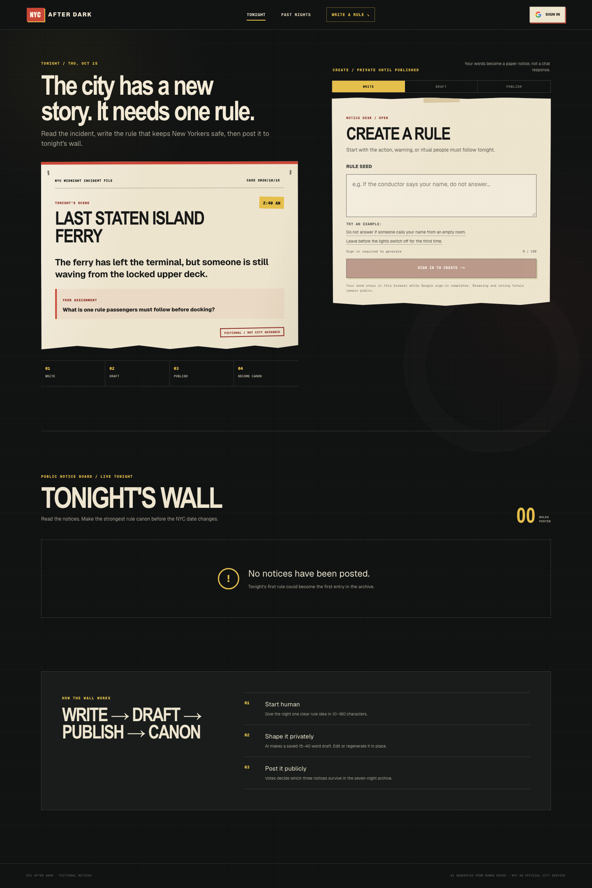
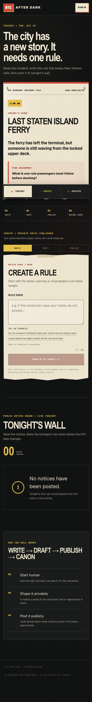
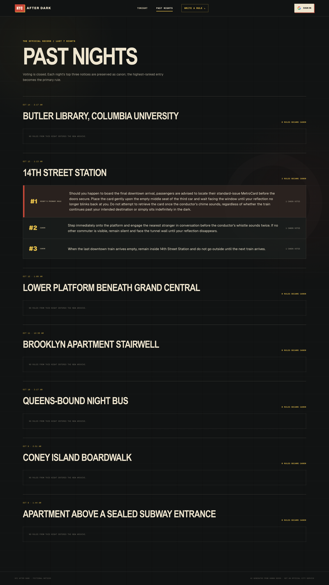

# NYC After Dark Snapshot — 2026.10.15.1

This is the canonical record of the vote-undo and owner-deletion release
captured on October 15, 2026. It preserves the production source, the final
environment-correction redeployment, the updated database contract, and the
public signed-out UI.

## Identity

| Field | Value |
| --- | --- |
| Snapshot version | `2026.10.15.1` |
| Captured | `2026-10-15 01:17:12 EDT` (`America/New_York`) |
| Source commit | `6eba51b7e7f1737bbd9fac8a8f96f351e4db52ba` |
| Source branch | `main` |
| Archive tag | `snapshot-2026-10-15-vote-undo-owner-delete` |
| Package version | `0.1.0` |
| Production URL | <https://coms6998-sand.vercel.app/> |
| Production deployment | <https://coms6998-onxuw2tvj-coms-6998.vercel.app/> |
| Vercel deployment ID | `5mecegQ1MiwDBL4Mv3h8jGLeQRBN` |
| GitHub deployment ID | `7076889110` |

To inspect this saved version after the tag exists:

```bash
git switch --detach snapshot-2026-10-15-vote-undo-owner-delete
```

## UI snapshot

The screenshots are production captures made while signed out. They contain
only public wall and archive data.

### Homepage — desktop, 1440 × 2156



### Homepage — mobile, 390 × 2948



### Past Nights — desktop, 1440 × 2559



See [UI capture metadata](ui/README.md) for checksums and reproduction details.

## What changed in this release

- A signed-in voter can remove their own Make Canon vote and vote again.
- The vote button is now a two-way control with counted and removed feedback.
- The author of a published rule sees a **Delete my rule** control with an
  explicit destructive-action confirmation.
- `DELETE /api/submissions/[id]` restricts deletion to the authenticated owner,
  tonight's stable scene ID and date, and a published submission.
- `DELETE /api/votes` restricts removal to the authenticated voter's own vote on
  tonight's published wall.
- A Supabase migration adds owner-delete and vote-delete policies and keeps
  cached vote totals correct after a vote is removed.
- The same source commit was redeployed after the Vercel environment
  configuration was corrected; this final redeployment is the one recorded
  above.

## Current product behavior

- Fourteen NYC scenes rotate by New York calendar date.
- Anyone can browse Tonight's Wall, vote totals, and the previous seven nights.
- Google authentication is required to generate, publish, vote, undo a vote, or
  delete a published rule.
- A 10–180 character human seed produces a private, editable 15–40 word notice.
- Users can edit or regenerate the saved draft before publishing it.
- Each authenticated user can cast or remove one vote per published rule.
- Only a published rule's author can delete it; its vote rows are removed by the
  database cascade.
- Nightly rules are ranked by persisted votes; the top three enter Past Nights.

## AI and data contracts

The generation model, prompt, output validation, timeout, and storage settings
are unchanged from `2026.10.14.1`. The exact contract is preserved in
[prompts/rule-generation.md](prompts/rule-generation.md).

Endpoints:

- `POST /api/generate`: authenticated draft creation or in-place regeneration.
- `PATCH /api/submissions/[id]/publish`: owner-only publication of a draft.
- `DELETE /api/submissions/[id]`: owner-only deletion of a published rule.
- `POST /api/votes`: add the authenticated user's vote.
- `DELETE /api/votes`: remove the authenticated user's vote.

Required migrations:

```text
supabase/migrations/20261007_week4_nyc_after_dark.sql
supabase/migrations/20261013_allow_draft_regeneration.sql
supabase/migrations/20261014_allow_vote_undo_and_owner_delete.sql
```

## Deployment evidence

- GitHub reports the Vercel status for source commit `6eba51b` as successful.
- The GitHub deployment record contains three successful Production statuses
  for the same source commit; the final redeployment completed at
  `2026-10-14 17:14:39 EDT`.
- The stable production URL and final commit-specific URL both returned HTTP
  `200` during capture.
- An unauthenticated `POST /api/generate` on the final deployment returned the
  expected HTTP `401` JSON response instead of an environment-configuration
  error, confirming that the Supabase-backed authentication path initializes.

## Verification recorded for this snapshot

- `npm run lint`: passed with two existing `no-img-element` warnings.
- `npx tsc --noEmit`: passed.
- `npm run build -- --webpack`: passed.
- `git diff --check`: passed.
- Desktop homepage: document client width and scroll width were both 1440 px.
- Mobile homepage: document client width and scroll width were both 390 px.
- Vercel Production deployment: successful and publicly reachable.

## Known boundaries

- The live wall had no October 15 rules during capture, so the signed-in undo
  and deletion controls are recorded in source rather than visible in the
  signed-out screenshot.
- A complete signed-in production generate → publish → vote → undo →
  delete recording is not included in this snapshot.
- The server-only `OPENAI_API_KEY` cannot be confirmed by the unauthenticated
  probe; a signed-in generation remains the appropriate end-to-end check.
- Confirm that `20261014_allow_vote_undo_and_owner_delete.sql` has been applied
  to the active Supabase project before relying on the new mutation paths.
